<div align="center">


<p>
  <a href="https://github.com/sankalpdevtester"></a>
  
  
  
</p>

<p>
  <a href="#about"><b>ABOUT</b></a> &nbsp;·&nbsp;
  <a href="#quests"><b>QUESTS</b></a> &nbsp;·&nbsp;
  <a href="#stack"><b>STACK</b></a> &nbsp;·&nbsp;
  <a href="#projects"><b>PROJECTS</b></a> &nbsp;·&nbsp;
  <a href="#stats"><b>STATS</b></a> &nbsp;·&nbsp;
  <a href="#achievements"><b>ACHIEVEMENTS</b></a> &nbsp;·&nbsp;
  <a href="#problem-solving"><b>PROBLEM SOLVING</b></a> &nbsp;·&nbsp;
  <a href="#connect"><b>CONNECT</b></a>
</p>

</div>

<a name="about"></a>

I build production-ready web applications, and I love digging into what makes them fast, reliable, and scalable: data structures, system design, and distributed systems. Open source is a big part of my focus too.

```ts
const sankalp = {
  name:      "Sankalp Gupta",
  role:      "Full Stack Developer",
  location:  "India",
  languages: ["Python", "TypeScript", "JavaScript", "Go", "Rust", "Java"],
  focus: [
    "Production-ready web applications",
    "Data structures & algorithms",
    "Open source contributions",
    "System design & distributed systems",
  ],
  learning: ["Cloud Architecture", "Advanced System Design", "Modern Web Technologies"],
} as const;
```

<a name="quests"></a>

| Quest type | Objective |
| :--- | :--- |
|  | Ship production-ready web applications |
|  | Contribute to open source |
|  | Level up on data structures & algorithms |
|  | Go deep on system design & distributed systems |
|  | Cloud Architecture, Advanced System Design, Modern Web Technologies |

<a name="stack"></a>

**Primary weapons** · core languages<br/>


**Sidearms** · more languages<br/>


**Frontend** · the visuals<br/>


**Engine room** · backend & databases<br/>


**Gadgets** · DevOps & tools<br/>


<a name="projects"></a>

> **[aether-db](https://github.com/sankalpdevtester/aether-db)** is my deep-dive into distributed systems: a key-value database built from scratch in Go with Raft consensus, write-ahead logging, and horizontal sharding, designed for millions of operations per second.

<p align="center">
  <a href="https://github.com/sankalpdevtester/aether-db"></a>
  <a href="https://github.com/sankalpdevtester/architectural-visualizer"></a>
</p>
<p align="center">
  <a href="https://github.com/sankalpdevtester/aegis-codefusion-2k26"></a>
  <a href="https://github.com/sankalpdevtester/code-vault-pro"></a>
</p>
<p align="center">
  <a href="https://github.com/sankalpdevtester/devops-pulse"></a>
  <a href="https://github.com/sankalpdevtester/forge-chain"></a>
</p>

<a name="stats"></a>

<p align="center">
  
  
</p>


<p align="center">
  
</p>

<p align="center">
  <picture>
    <source media="(prefers-color-scheme: dark)" srcset="https://raw.githubusercontent.com/sankalpdevtester/sankalpdevtester/output/github-contribution-grid-snake-dark.svg">
    <source media="(prefers-color-scheme: light)" srcset="https://raw.githubusercontent.com/sankalpdevtester/sankalpdevtester/output/github-contribution-grid-snake.svg">
    
  </picture>
</p>

<a name="achievements"></a>

<p align="center">
  
  
</p>

<a name="problem-solving"></a>

Data structures & algorithms are a core focus for me. This is my LeetCode activity over the last year.

<p align="center">
  
</p>

<a name="connect"></a>


<p align="center">
  <a href="https://github.com/sankalpdevtester"></a>
  
  <!-- Add your own: LinkedIn, email, portfolio, X/Twitter -->
</p>

<p align="center">Always happy to talk code, distributed systems, or open source.</p>


<p align="center">
  
</p>

